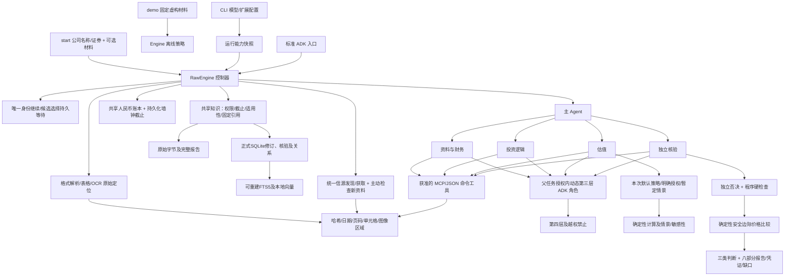

# 架构说明

适用版本：0.5.0（Unreleased）。文档入口见[索引](README.md)。

`start`及ADK/API默认进入 `RawEngine` 正式研究，初始材料可为空；显式demo使用 `Engine` 的固定离线策略，历史运行按原快照加载。两者复用现有公共控制器、Pydantic合约及ADK执行路径，未删除旧引擎。`RawBackend` 通过原有LiteLlm作单次结构化决策，没有共享聊天历史或隐藏工具循环。Worker在自身ADK生命周期中调用一次BaseLlm请求，不再逐行动创建内部Runner／Session；主协调、提取和独立审查仍采用隔离决策Runner。实际安装ADK 2.11.0的Runner、LlmAgent、Session、ToolContext、原生工具事件及回调用于执行；未升级ADK或改用另一套平台。

## 宿主入口与执行者

`host_contract.py` 的 Pydantic 输入同时供 CLI、schema 发现和 `host_mcp.py` 的固定 SDK stdio 服务使用；`host_service.py` 持久化提交／操作意图并提供统一访问、查询及幂等入口，`host_worker.py` 启动脱离 stdio 的单任务本机执行者，仍调用现有 `run_engine`、控制器及共享原生 App／插件。`.host/requests.sqlite` 不保存预算或结算；执行锁只提供存活观察，状态与账本仍由原 Engine／RawEngine 写入。启动失败／中断明确投影，查询不自动恢复。取舍见[ADR 0003](decisions/0003-local-host-lifecycle.md)。

新宿主研究由控制器在交付时通过 `host_outputs.py` 保存不可变内容寻址成果代次和证据字节，原 `report-vN` 路径继续兼容旧入口。成果代次、假设版本和状态 CAS 分开；旧版缺失／篡改明确失败。原只读 ADK Artifact 指针和所属 Session 检查保留，宿主没有提交映射的已绑定研究仍被拒绝。完整契约见[宿主指南](HOSTS.md)。

## 模块与状态

- `configuration.py`：项目能力配置、原子写入、环境变量引用与扩展响应脱敏。CLI 提供 `configure`、`models`、`extensions` 的交互及脚本入口。
- `models.py`：LLM／OCR 配置和选择；兼容 API LLM、Tesseract、视觉 OCR、JSON OCR 命令及 `paddle_api.py` 的异步任务适配。OCR 在初始解析与后续获取中沿用所选适配器，模型 OCR 共用费用账本。
- `extensions.py`：技能及资源复制、MCP 原生工具集连接与分页发现、命令工具执行、参数 schema、角色授权和运行快照。扩展原响应作为来源凭证保存；不是确定性财务计算凭证。
- `adk_mcp.py`：固定 McpToolset／McpTool／MCPSessionManager 生命周期适配，同任务连接复用、冻结定义过滤和核对、退出清理。保留业务别名、禁止隐式ADC和重定向凭据转发，不开放 UI 动作或资源权限。
- `terminal_status.py`：仅在 CLI stderr 终端上报告 OSC 7501 状态；不改变引擎业务状态、退出码或 JSON 响应。
- `information.py`：现有信息工具及Tushare、Tavily、Yahoo/yfinance只读适配，具体操作白名单、实际来源／访问方式元数据和安全完整响应；按既有扩展入口注册，配置见[信息来源](INFORMATION_SOURCES.md)。
- `knowledge/`：SQLite正式记录、不可变修订、来源字节、可恢复文件提交、核验内容哈希、基准版本CAS、固定引用、FTS5／本地向量及明确要求。`runtime.py`仅由现有控制器管理归档、独立核验和提交。
- `sources.py`：发现与获取分离的统一合约；web_search及信息工具返回的原文地址使用同一获取、截止和归档路径，支持不透明cursor／checkpoint；没有订阅调度或交互浏览器。
- `materials.py`：原始字节、格式解析、来源日期依据、原文 anchors、公开发现与获取；目录自动建立内部 index，不要求用户准备 manifest。
- `financial_analysis.py`：固定科目、指标、可比期间、平均余额、数据质量与统一异常调查信号；不推算分部或定义行业阈值。
- `investment_logic.py`：结构化清单兼容、纯数学经营预期比较及各模型差异；不写业务状态。
- `judgment.py`：读取既有事实、报价、假设版本、计算凭证和独立核验，确定性核对安全边际及三类判断；不选择比例、不创建另一套授权或费用状态，历史／演示保持旧语义。
- `v2_tools.py`：原文数值校验、提取登记、冲突保留、EBIT桥接、单一valuation入口按方法分派、统一凭证及独立程序复核。
- `valuation/`：PE/PB/EV-EBITDA/单阶段DDM的纯数学、方法输入门槛与结构化基准比较；不批准参数、不改变运行状态、不发布报告。Pydantic契约统一在`schemas.py`。
- `budget.py`：一个完整研究任务的原子费用预留、用量核算及总墙钟截止；新建任务默认上限 2 小时，其中预留 30 秒收尾。等待、重试、第三层及恢复不另起预算。
- `frameworks.py`：三个内置基线、原文与草稿、不可变规则快照、独立核验后可选择的版本。
- `research.py`：正式调度、身份候选等待／选择、适用来源换源、行情绑定、阶段和方法适用性、默认策略及明确授权、第三层创建、共享读取／消息和主Agent批准转派；仍是业务state.json的唯一写入者。
- `adk_app.py`：隔离任务的原生工具执行和回调；每个动态角色创建新的 ADK Agent／Session，避免修改共享网页 Agent 的任务上下文或子 Agent 列表。
- `adk_runtime.py`：固定 ADK 2.11.0 的 App／生命周期插件工厂，覆盖外部入口、Worker 和独立决策 Runner。持久化脱敏事件投影，关联 run／task／parent task／Session／invocation；不修改业务状态或结算费用。
- `api.py`：原生 ADK ApiServer 和持久 SQLite Session，增加所属 Session 的研究轨迹读取；不是认证或多租户服务器。`fast_api_app.py` 为本地入口。
- `agents-cli-manifest.yaml`及`yantra/fast_api_app.py`：固定CLI识别与package入口。合成行为案例、真实调用预算门槛及分层CI见[开发指南](DEVELOPMENT.md)；不修改研究模型、升级依赖或引入云设施。
- `adk_artifacts.py`：只读 BaseArtifactService 桥接控制器已有报告与计算文件，索引 ADK 版本、业务版本及内容哈希；不复制产物、不暴露原始材料、不写证据修订。
- `adk_skills.py`：显式只读 SkillToolset 试点，按任务冻结目录／角色／父权限发现和加载，重复收据用固定引用投影；权威材料和原日志由既有接口维护。默认完整注入及旧运行行为保留。
- `replay.py`：固定字节和版本的离线复算及程序复核，不冒充远程模型推理的重放。

运行、任务、假设、框架与研究标准有独立标识和版本。子任务记录父任务、发起方、执行角色、深度、工具及共享引用、完成条件；费用账本记录任务归属、方法、版本、预留、用量、价格及价格时点。原始资料、提取结果、任务和报告保存在同一运行目录。

`state.capabilities` 固定模型标识、端点、价格、凭据变量名、扩展 schema 与角色。技能资源复制到 `capabilities/skills/` 并记录哈希；恢复不读取新的默认选择。命令程序、远端模型权重和 MCP 服务实现本身不由 Yantra 冻结。v0.1 固定演示沿用原有工具集；详情见 [能力模块说明](CAPABILITIES.md)。

新正式运行记录 `research_flow_version=2`。`pending_user.kind=identity` 保存已定位原文的候选及稳定ID，CLI的 `resume --select-identity` 与API同Session的 `/select-identity` 调用同一控制器恢复方法；等待和选择不重置预算、截止或既有费用。身份未定时不估值，后续来源、财务及报价绑定同一证券、交易币种和股类。新接口不替换历史status、resume或固定replay。

准备获取仅调用冻结快照中已启用、费用／凭据／依赖就绪且获finance权限的适用工具，并记录 `information_attempts`；同一请求不自动重试，必要的新查询仍可补查。搜索命中进入既有网页抓取与材料归档，discovery与实际原文分开；缺浏览器、登录限制或服务不可用均保留缺口。新服务模板停用且费用unknown，不隐式启用。原账本承担逐次预留与结果未知时的保留，换源不能绕过角色或额度。

## 权限与协作

四个专业角色拥有各自工具集。第三层的工具必须是父授权工具的子集，禁止再次创建。第三层只接收获准输入及框架快照；既不共享全部历史，也不能改名扩大权限。

`collaborate(read/message)` 只访问任务包列出的共享引用；消息以收件箱传入匹配任务。`request_transfer` 仅创建申请，含目的、输入、完成条件和工具预算。`approve_transfer` 由主 Agent 发起后，控制器检查共享边界和剩余额度，才创建新执行任务。共享消息不能隐含转移责任或创建任务。

专业执行通过预算内后端行动映射为 ADK 原生工具事件；工具前回调与控制器再次校验。上下文由 ContextVar 绑定当前任务，动态子任务结束后恢复父绑定。每项运行还使用文件锁，防止不同进程同时修改运行状态。

App 插件覆盖仅限所属 Runner；独立决策与 Worker Runner 显式使用同一工厂。`adk-trace.jsonl` 只保存事件标识、调用名称、内容哈希、状态和原生用量，不保存参数、子任务正文、思维内容或原始错误消息。`adk-scopes.json` 记录控制器实际绑定的外部 Session，轨迹读取及已绑定研究恢复拒绝其他 Session 借用 run ID。内部 Session 继续隔离，投影没有转发为外层 ADK 事件，不重复状态 delta、工具调用或收费。

轨迹接口另读`state.json`给出`controller`投影：原模型／OCR账本收据、owner_invocation_id、总预算和准备检索的目的／结果数。非ADK程序操作不会伪造原生事件；投影与观测不能相加计费。提供者／工具错误只给安全类别，实际账单仍不可得。API生命周期关闭其自建DatabaseSessionService，注入服务的所有权保留给调用方。

当前任务状态及账本仍以 `state.json` 为准；投影是观测数据。绑定文件及投影不能替代证据修订。原生化职责及自定义例外见 [ADR 0002](decisions/0002-adk-native-boundaries.md)。

专业任务的插件在 `after_run` 释放扩展连接，取消路径另由 Runner 的插件 `close` 保证释放；第三层不拥有父任务连接的关闭权。外部操作的持久 `in_flight_tool` 由控制器写入／清除，费用由原账本结算。取消或进程中断后，恢复拒绝自动重放结果未知的操作，不重置费用／工具次数或墙钟截止；没有成果包的终止任务在轨迹中为 interrupted。业务控制器仍串行调度；连接层并发通过不代表业务状态支持并行写入。

Worker 的 `WorkerDecisionModel` 仍将经过预算和结构校验的业务行动转换为 ADK 工具调用；自定义理由是保留既有结构化行动与显式程序门槛，不要求模型新增函数调用能力。请求只含当前 task＋local、固定指令及结构，超时和取消关闭提供者生成器；实际用量只转入该 Worker 的一个原生事件，账本只由 `_decision` 结算。主控制器没有整体迁移到 Workflow；阶段和独立否决继续由业务程序保障。

## 估值、核验与失效

空首次偏好仅产生本次版本0／unspecified快照，不写入长期偏好或用户同意，选择来源为 `default_policy`。实际已保存设置复用知识偏好版本；长期授权、本次覆盖和交付方式分别记录。显式范围内自主选择为controller，人工确认为user，拒绝、撤销或manual未回复为provisional（confirmed=false）。主／辅助模型各自保存参数、依据、版本和凭证，分别核验；默认自主选择不豁免来源或数学门槛。授权及工具请求核对方法、参数、版本和任务快照，按方法核验证券、股类、币种、期间及财务口径。整体权益换算每股需要匹配总股数；新DCF要求EBIT桥接及明确少数股东权益，OCF倒推仍未开放给新研究。旧快照和演示保留原算法；没有适用方法时以not_applicable和缺口交付已有研究。

单一可靠来源可支持初步判断，不以外部来源数量代替独立核验。接口JSON定位、原始披露定位和抓取日志的证明范围不同；财务聚合数据须有原始披露依据，报价完整响应核对实际时间及未复权属性。冲突及解释保留原记录；关键冲突／否决阻止受影响判断。主估值保存安全边际ratio及理由，judgment按基准每股价值计算阈值并输出“值得买／暂不值得买／目前无法判断”，嵌入既有投资结论摘要；研究status与判断分开，规则见[估值说明](VALUATION.md#安全边际与买入判断)。

新增方法复用calc:<hash>凭证。重放重建输入并数学计算，不读取outputs充当复算，未知类型和数值篡改明确失败。缺市场基准保留unresolved；thesis保留解释，工具与报告使用同一结构化基准。细节与历史映射见[估值运行说明](USAGE.md)。

程序核验检查原始位置、数值、哈希、计算复现与版本；模型核验另判断经济逻辑、风险、假设和方法。主 Agent 不能将模型否决改成通过。标准修订只增加有版本的研究判断要求，不能移除硬检查；影响的论点、估值和核验失效。用户自定义框架在启动时通过独立核验后用于本次；运行中的调整草稿供以后研究选择，当前基线保持固定。

参数修改形成新版本并失效受影响成果；正常恢复不重置预算。取消请求在下一预算边界生效。HTTP、OCR、材料分页处理及模型调用均检查剩余时间；全局硬上限前预留报告和持久化时间。

## 可核查边界

Vision OCR 的独立决策 Runner 也通过统一 App／插件。初始解析和 Worker 中的 OCR 线程保留调用者 ContextVar，以 finance／当前任务、父 invocation 及运行ID关联观测；收费收据仍由原OCR预算路径写入并记录task_id，图像内容不进入公开投影。模型OCR的关联测试使用合成提供者，不是远端OCR服务验收。

模型原文提取通过程序数值校验不等于财务口径和经济判断已证实。日期从原始 URL 推断时保留依据；未知日期不能用于历史截止。复杂表格、图片图表、Excel 未缓存公式及旧二进制办公格式均保留限制。原始运行的 `completed` 门槛不因采用框架或得到某项格式转换结果而降低。

## v0.3 知识与判断流程

启动读取目标公司资料目录、适用事实、重点历史论点和问题，再按研究问题检索其他公司／行业／主题。来源全文和完整报告按需读取。公司ID与证券ID分别保存；同名不合并，不同证券类别只有明确company ID才归属同一公司。

研究Agent只能搜索、读取和提议。verification任务单独注册，核验逐条原文、口径、推理、假设和反证，绑定提议的语义内容哈希。控制器串行提交并检查公司基准版本；旧基准冲突不会覆盖新修订。归档候选允许pending/rejected，不能继承全报告passed。论点judgment与verification是两个字段，历史论点不能取得本次结论资格。

每次thesis成果保存不可变判断快照，再比较历史重点论点和未关闭问题。比较结果进入后续任务和核验上下文，支持后续补查、提议及新版本。业务／集团scope不匹配不能直接支持或反驳旧论点。完整修订仍由独立核验判断，程序不自行作经济判断。

研究保存采用过的知识修订与证据hash/locator。resume冻结模型配置、预算和截止；replay只读原固定版本，复算原估值和程序核验，不重做远程历史比较。永久删除标记受影响session来源缺失，replay明确拒绝。

正式数据、派生索引、编辑删除与要求优先级详见[知识契约及命令](KNOWLEDGE.md)。

默认策略快照、身份等待、暂定选择和后续编辑继续由RawEngine写入state.json。已核对ADK 2.11.0的ToolContext.request_confirmation：原生确认服务于暂停／响应流程，不提供投资授权版本、撤销、暂定情景发布和证据依赖失效。沿用既有业务控制器补充这些契约；执行、Session、工具／插件生命周期和只读Artifact仍由现有原生工厂提供。API轨迹只读显示证券身份、等待种类、偏好版本和选择状态，不复制候选原文或选择正文到脱敏轨迹。
