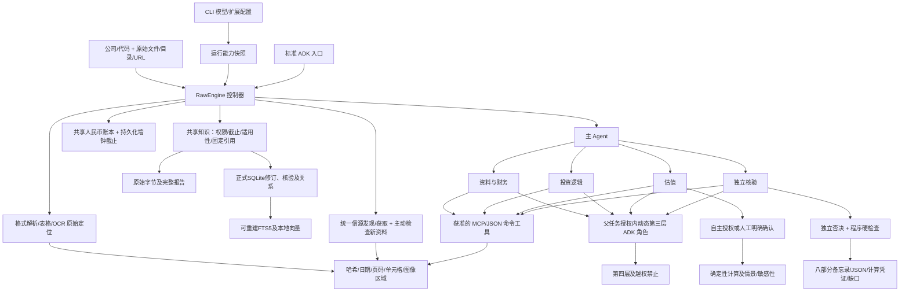

# 架构说明

适用版本：0.3.3 与 Unreleased ADK 接入。文档入口见[索引](README.md)。

`Engine` 保留 v0.1 固定材料执行保障，`RawEngine` 在同一控制器、Pydantic 合约及 ADK 执行路径上增加原始材料研究。`RawBackend` 通过原有 `LiteLlm` 作单次结构化决策；没有共享聊天历史，也没有隐藏工具循环。实际安装 ADK 2.11.0 的 `Runner`、`LlmAgent`、Session、`ToolContext`、原生工具事件及回调用于执行。未升级 ADK 或改用另一套 Agent 平台。

## 模块与状态

- `configuration.py`：项目能力配置、原子写入、环境变量引用与扩展响应脱敏。CLI 提供 `configure`、`models`、`extensions` 的交互及脚本入口。
- `models.py`：LLM／OCR 配置和选择；兼容 API LLM、Tesseract、视觉 OCR、JSON OCR 命令及 `paddle_api.py` 的异步任务适配。OCR 在初始解析与后续获取中沿用所选适配器，模型 OCR 共用费用账本。
- `extensions.py`：技能及资源复制、MCP SDK 连接与工具发现、命令工具执行、参数 schema、角色授权和运行快照。扩展原响应作为来源凭证保存；不是确定性财务计算凭证。
- `terminal_status.py`：仅在 CLI stderr 终端上报告 OSC 7501 状态；不改变引擎业务状态、退出码或 JSON 响应。
- `information.py`：扶摇、东方财富、AKShare 与 98dou 的只读 JSON 命令工具；按既有扩展入口注册，配置见[信息来源](INFORMATION_SOURCES.md)。
- `knowledge/`：SQLite正式记录、不可变修订、来源字节、可恢复文件提交、核验内容哈希、基准版本CAS、固定引用、FTS5／本地向量及明确要求。`runtime.py`仅由现有控制器管理归档、独立核验和提交。
- `sources.py`：发现与获取分离的统一合约；现有web_search使用同一入口，支持不透明cursor／checkpoint存储，无新信源服务或订阅调度。
- `materials.py`：原始字节、格式解析、来源日期依据、原文 anchors、公开发现与获取；目录自动建立内部 index，不要求用户准备 manifest。
- `v2_tools.py`：原文数值校验、提取登记、冲突保留、EBIT桥接、单一valuation入口按方法分派、统一凭证及独立程序复核。
- `valuation/`：PE/PB/EV-EBITDA/单阶段DDM的纯数学、方法输入门槛与结构化基准比较；不批准参数、不改变运行状态、不发布报告。Pydantic契约统一在`schemas.py`。
- `budget.py`：一个完整研究任务的原子费用预留、用量核算及总墙钟截止；新建任务默认上限 2 小时，其中预留 30 秒收尾。等待、重试、第三层及恢复不另起预算。
- `frameworks.py`：三个内置基线、原文与草稿、不可变规则快照、独立核验后可选择的版本。
- `research.py`：原始调度、阶段和方法适用性、自主授权、第三层创建、共享读取／消息及主 Agent 批准转派；v0.2.1 将冻结的技能指令和扩展工具接入此路径。
- `adk_app.py`：隔离任务的原生工具执行和回调；每个动态角色创建新的 ADK Agent／Session，避免修改共享网页 Agent 的任务上下文或子 Agent 列表。
- `adk_runtime.py`：固定 ADK 2.11.0 的 App／生命周期插件工厂，覆盖外部入口、Worker 和独立决策 Runner。持久化脱敏事件投影，关联 run／task／parent task／Session／invocation；不修改业务状态或结算费用。
- `api.py`：原生 ADK ApiServer 和持久 SQLite Session，增加所属 Session 的研究轨迹读取；不是认证或多租户服务器。`fast_api_app.py` 为本地入口。
- `replay.py`：固定字节和版本的离线复算及程序复核，不冒充远程模型推理的重放。

运行、任务、假设、框架与研究标准有独立标识和版本。子任务记录父任务、发起方、执行角色、深度、工具及共享引用、完成条件；费用账本记录任务归属、方法、版本、预留、用量、价格及价格时点。原始资料、提取结果、任务和报告保存在同一运行目录。

`state.capabilities` 固定模型标识、端点、价格、凭据变量名、扩展 schema 与角色。技能资源复制到 `capabilities/skills/` 并记录哈希；恢复不读取新的默认选择。命令程序、远端模型权重和 MCP 服务实现本身不由 Yantra 冻结。v0.1 固定演示沿用原有工具集；详情见 [能力模块说明](CAPABILITIES.md)。

## 权限与协作

四个专业角色拥有各自工具集。第三层的工具必须是父授权工具的子集，禁止再次创建。第三层只接收获准输入及框架快照；既不共享全部历史，也不能改名扩大权限。

`collaborate(read/message)` 只访问任务包列出的共享引用；消息以收件箱传入匹配任务。`request_transfer` 仅创建申请，含目的、输入、完成条件和工具预算。`approve_transfer` 由主 Agent 发起后，控制器检查共享边界和剩余额度，才创建新执行任务。共享消息不能隐含转移责任或创建任务。

专业执行通过预算内后端行动映射为 ADK 原生工具事件；工具前回调与控制器再次校验。上下文由 ContextVar 绑定当前任务，动态子任务结束后恢复父绑定。每项运行还使用文件锁，防止不同进程同时修改运行状态。

App 插件覆盖仅限所属 Runner；独立决策与 Worker Runner 显式使用同一工厂。`adk-trace.jsonl` 只保存事件标识、调用名称、内容哈希、状态和原生用量，不保存参数、子任务正文、思维内容或原始错误消息。`adk-scopes.json` 记录控制器实际绑定的外部 Session，轨迹读取及已绑定研究恢复拒绝其他 Session 借用 run ID。内部 Session 继续隔离，投影没有转发为外层 ADK 事件，不重复状态 delta、工具调用或收费。

当前任务状态及账本仍以 `state.json` 为准；投影是观测数据。绑定文件及投影不能替代证据修订。原生化职责及自定义例外见 [ADR 0002](decisions/0002-adk-native-boundaries.md)。

## 估值、核验与失效

自主授权独立记录为 `controller`，人工确认为 `user`。授权及工具请求核对方法＋参数＋版本和当前任务快照，按方法核验来源、日期、币种、证券类别、期间及财务口径。整体权益换算每股需要匹配总股数；EPS×PE/BVPS×PB核验每股指标。新原始材料DCF要求EBIT桥接及明确少数股东权益；OCF倒推尚未开放给新研究，旧快照与固定演示保留旧算法。不具备有效方法时保留not_applicable和研究partial。三个研究框架与估值方法分别选择，保持finance→thesis→valuation→verification→report。

新增方法复用calc:<hash>凭证。重放重建输入并数学计算，不读取outputs充当复算，未知类型和数值篡改明确失败。缺市场基准保留unresolved；thesis保留解释，工具与报告使用同一结构化基准。细节与历史映射见[估值运行说明](USAGE.md)。

程序核验检查原始位置、数值、哈希、计算复现与版本；模型核验另判断经济逻辑、风险、假设和方法。主 Agent 不能将模型否决改成通过。标准修订只增加有版本的研究判断要求，不能移除硬检查；影响的论点、估值和核验失效。用户自定义框架在启动时通过独立核验后用于本次；运行中的调整草稿供以后研究选择，当前基线保持固定。

参数修改形成新版本并失效受影响成果；正常恢复不重置预算。取消请求在下一预算边界生效。HTTP、OCR、材料分页处理及模型调用均检查剩余时间；全局硬上限前预留报告和持久化时间。

## 可核查边界

模型原文提取通过程序数值校验不等于财务口径和经济判断已证实。日期从原始 URL 推断时保留依据；未知日期不能用于历史截止。复杂表格、图片图表、Excel 未缓存公式及旧二进制办公格式均保留限制。原始运行的 `completed` 门槛不因采用框架或得到某项格式转换结果而降低。

## v0.3 知识与判断流程

启动读取目标公司资料目录、适用事实、重点历史论点和问题，再按研究问题检索其他公司／行业／主题。来源全文和完整报告按需读取。公司ID与证券ID分别保存；同名不合并，不同证券类别只有明确company ID才归属同一公司。

研究Agent只能搜索、读取和提议。verification任务单独注册，核验逐条原文、口径、推理、假设和反证，绑定提议的语义内容哈希。控制器串行提交并检查公司基准版本；旧基准冲突不会覆盖新修订。归档候选允许pending/rejected，不能继承全报告passed。论点judgment与verification是两个字段，历史论点不能取得本次结论资格。

每次thesis成果保存不可变判断快照，再比较历史重点论点和未关闭问题。比较结果进入后续任务和核验上下文，支持后续补查、提议及新版本。业务／集团scope不匹配不能直接支持或反驳旧论点。完整修订仍由独立核验判断，程序不自行作经济判断。

研究保存采用过的知识修订与证据hash/locator。resume冻结模型配置、预算和截止；replay只读原固定版本，复算原估值和程序核验，不重做远程历史比较。永久删除标记受影响session来源缺失，replay明确拒绝。

正式数据、派生索引、编辑删除与要求优先级详见[知识契约及命令](KNOWLEDGE.md)。
