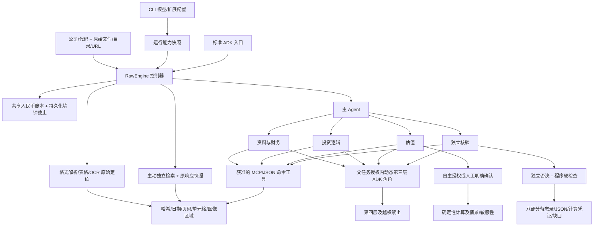

# Yantra v0.2.1 架构

`Engine` 保留 v0.1 固定材料执行保障，`RawEngine` 在同一控制器、Pydantic 合约及 ADK 执行路径上增加原始材料研究。`RawBackend` 通过原有 `LiteLlm` 作单次结构化决策；没有共享聊天历史，也没有隐藏工具循环。实际安装 ADK 2.11.0 的 `Runner`、`LlmAgent`、Session、`ToolContext`、原生工具事件及回调用于执行。未升级 ADK 或改用另一套 Agent 平台。

## 模块与状态

- `configuration.py`：项目能力配置、原子写入、环境变量引用与扩展响应脱敏。CLI 提供 `configure`、`models`、`extensions` 的交互及脚本入口。
- `models.py`：LLM／OCR 配置和选择；兼容 API LLM、Tesseract、视觉 OCR 及 JSON OCR 命令。OCR 在初始解析与后续获取中沿用所选适配器，模型 OCR 共用费用账本。
- `extensions.py`：技能及资源复制、MCP SDK 连接与工具发现、命令工具执行、参数 schema、角色授权和运行快照。扩展原响应作为来源凭证保存；不是确定性财务计算凭证。
- `materials.py`：原始字节、格式解析、来源日期依据、原文 anchors、公开发现与获取；目录自动建立内部 index，不要求用户准备 manifest。
- `v2_tools.py`：原文数值校验、提取登记、冲突保留、部分可计算指标及独立程序复核。
- `budget.py`：一个完整研究任务的原子费用预留、用量核算及总墙钟截止；新建任务默认上限 2 小时，其中预留 30 秒收尾。等待、重试、第三层及恢复不另起预算。
- `frameworks.py`：三个内置基线、原文与草稿、不可变规则快照、独立核验后可选择的版本。
- `research.py`：原始调度、阶段和方法适用性、自主授权、第三层创建、共享读取／消息及主 Agent 批准转派；v0.2.1 将冻结的技能指令和扩展工具接入此路径。
- `adk_app.py`：隔离任务的原生工具执行和回调；每个动态角色创建新的 ADK Agent／Session，避免修改共享网页 Agent 的任务上下文或子 Agent 列表。
- `replay.py`：固定字节和版本的离线复算及程序复核，不冒充远程模型推理的重放。

运行、任务、假设、框架与研究标准有独立标识和版本。子任务记录父任务、发起方、执行角色、深度、工具及共享引用、完成条件；费用账本记录任务归属、方法、版本、预留、用量、价格及价格时点。原始资料、提取结果、任务和报告保存在同一运行目录。

`state.capabilities` 固定模型标识、端点、价格、凭据变量名、扩展 schema 与角色。技能资源复制到 `capabilities/skills/` 并记录哈希；恢复不读取新的默认选择。命令程序、远端模型权重和 MCP 服务实现本身不由 Yantra 冻结。v0.1 固定演示沿用原有工具集；详情见 [能力模块说明](CAPABILITIES_V0_2_1.md)。

## 权限与协作

四个专业角色拥有各自工具集。第三层的工具必须是父授权工具的子集，禁止再次创建。第三层只接收获准输入及框架快照；既不共享全部历史，也不能改名扩大权限。

`collaborate(read/message)` 只访问任务包列出的共享引用；消息以收件箱传入匹配任务。`request_transfer` 仅创建申请，含目的、输入、完成条件和工具预算。`approve_transfer` 由主 Agent 发起后，控制器检查共享边界和剩余额度，才创建新执行任务。共享消息不能隐含转移责任或创建任务。

专业执行通过预算内后端行动映射为 ADK 原生工具事件；工具前回调与控制器再次校验。上下文由 ContextVar 绑定当前任务，动态子任务结束后恢复父绑定。每项运行还使用文件锁，防止不同进程同时修改运行状态。

## 估值、核验与失效

自主授权独立记录为 `controller`，人工确认为 `user`。同一版本的参数、可核对现金流口径、股数及币种必须对应。OCF−资本开支未调节时只作为指标，不作 FCFF。模型不适用时可跳过 DCF，继续论证与核验，保留 partial。

程序核验检查原始位置、数值、哈希、计算复现与版本；模型核验另判断经济逻辑、风险、假设和方法。主 Agent 不能将模型否决改成通过。标准修订只增加有版本的研究判断要求，不能移除硬检查；影响的论点、估值和核验失效。用户自定义框架在启动时通过独立核验后用于本次；运行中的调整草稿供以后研究选择，当前基线保持固定。

参数修改形成新版本并失效受影响成果；正常恢复不重置预算。取消请求在下一预算边界生效。HTTP、OCR、材料分页处理及模型调用均检查剩余时间；全局硬上限前预留报告和持久化时间。

## 可核查边界

模型原文提取通过程序数值校验不等于财务口径和经济判断已证实。日期从原始 URL 推断时保留依据；未知日期不能用于历史截止。复杂表格、图片图表、Excel 未缓存公式及旧二进制办公格式均保留限制。原始运行的 `completed` 门槛不因采用框架或得到某项格式转换结果而降低。
