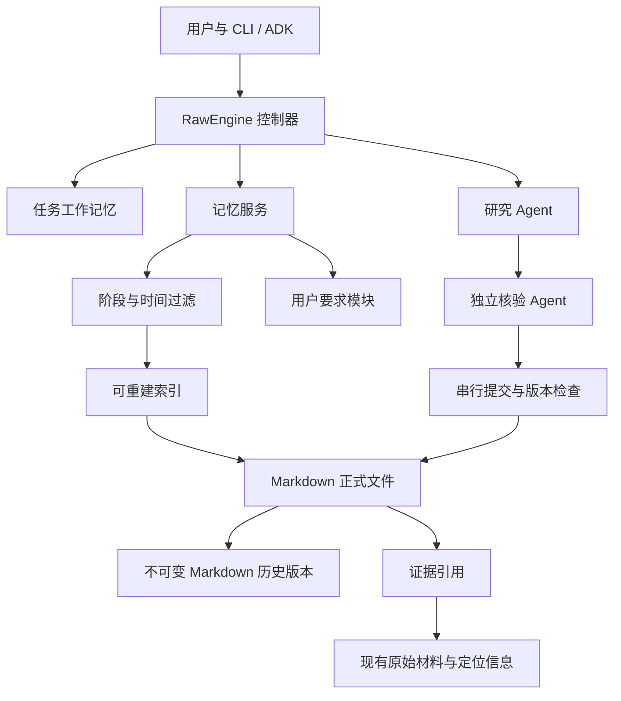
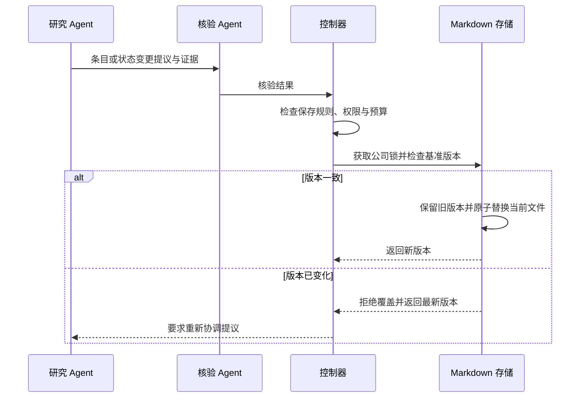

# 智能体记忆系统_提案

> 历史提案／审阅：v0.3，2026-10-13。保留原建议及已记录的实施差异，当前操作见[文档索引](../README.md)。

> 项目：Yantra｜目标版本：v0.3｜日期：2026-10-13
> 状态：原始设计提案，保留讨论历史；v0.3实际实现以[开发提示词](../prompts/v0.3.md)与[实现契约](../KNOWLEDGE.md)为准。本文不表示功能已实现。
> 决策依据：本轮设计讨论。工程细节为建议，实施前需结合代码验证。

## 1. 目标与设计理念

记忆系统使同一家公司的研究可以持续积累。后续研究应识别旧判断的变化，也应纠正旧判断的错误。

系统保存可追踪的事实、关键投资论点和待核验问题。系统必须记录每个判断的依据、时间和版本。旧结论不能自动成为本次研究的事实依据。

v0.3 的核心场景如下：

1. 第一次研究形成判断和记忆。
2. 第二次研究读取允许复用的历史事实和问题。
3. Agent 独立形成本次判断，并固定快照。
4. Agent 比较新旧判断。
5. Agent 根据差异补充核查。
6. 核验通过后，系统发布修订结果并更新记忆。


## 2. 范围与原则

### 2.1 v0.3 范围

| 纳入范围 | 暂不纳入范围 |
|---|---|
| 同一公司的持续研究 | 跨公司的研究经验学习 |
| 任务工作记忆与公司长期记忆 | 自动推断用户偏好 |
| 明确指令驱动的用户要求模块 | 行业级用户要求 |
| Markdown 正式存储与可重建索引 | 向量数据库与语义检索 |
| 固定材料验收 | 自动长期监控 |

真实公司研究可用于后续实用性验证。v0.3 首先用固定两期材料验证机制。

### 2.2 基本原则

- **区分可信状态和使用范围。** 长期记忆不一定适用于当前研究。新事实也不一定已通过核验。
- **按条目准入。** `partial` 研究中的已核验条目可以进入长期记忆。
- **保留历史。** 更新不得删除旧研究所引用的版本。
- **保留冲突。** 系统不得用“最新”代替冲突核查。
- **明确时间。** 系统分别记录报告期间、披露时间、研究截止时间和记录时间。
- **限制读取。** 程序执行阶段权限。提示词不能代替访问控制。
- **统一写入。** 同一公司的更新依次提交。提交必须检查基准版本。
- **沿用约束。** 记忆操作使用现有预算、任务权限和核验否决机制。

## 3. 记忆框架

| 模块 | 内容 | 使用方式 | 写入依据 |
|---|---|---|---|
| 任务工作记忆 | 计划、提取候选、临时假设、待办、核验过程 | 当前任务推进和恢复 | 运行过程记录 |
| 公司长期记忆 | 已核验事实、关键论点、问题、研究快照、冲突记录 | 后续研究接续和比较 | 自动选择及逐条核验 |
| 用户要求与偏好 | 全局默认要求、特定公司要求 | 配置任务及调整默认行为 | 用户明确记忆指令 |

任务结束后，工作记忆可以继续归档。归档不等于进入跨任务检索。

公司索引提供导航。原始材料保留在现有材料档案中。Markdown 条目引用材料，不复制整份财报。

### 3.1 长期保存规则

条目必须通过核验，并至少满足一条规则：

| 规则 ID | 保存条件 |
|---|---|
| R1 | 支撑或反驳正式报告中的关键投资论点 |
| R2 | 影响估值适用性、关键输入或主要风险判断 |
| R3 | 解决已登记问题，或形成值得后续追踪的新问题 |
| R4 | 纠正旧记忆错误，或解释记录之间的冲突 |

Agent 自动选择条目。Agent 必须记录规则 ID 和具体保存理由。未命中规则的内容留在运行档案中。

事实核验检查来源和提取。论点核验检查推理、假设和反证。问题核验检查问题是否有依据及后续价值，不把未知答案标为已证实。

### 3.2 关键论点

系统只持续跟踪影响投资判断、估值适用性或主要风险的论点。其他分析保留在研究快照中。

论点包含：主张、支持证据、反对证据、关键假设、失效条件、状态和历次修订。研究 Agent 提议状态变更。核验 Agent 确认后，控制器提交更新。

建议状态为 `open`、`supported`、`weakened`、`refuted`、`unresolved` 和 `closed`。这些状态表示研究判断，不表示客观事实的概率。未通过的变更提议保留在运行档案中。

## 4. 系统架构



记忆服务管理读取、检索、版本和提交。Agent 不直接绕过服务读取公司记忆目录。手动编辑不受此工具限制，但编辑结果必须进入变更检测流程。

建议新增 `yantra/memory/`。优先复用现有 Pydantic 合约、文件锁、原子写入和控制器机制。

| 建议模块 | 职责 |
|---|---|
| `schemas.py` | 条目、引用、修订、偏好和查询合约 |
| `store.py` | Markdown 解析、历史版本、原子提交和文件锁 |
| `index.py` | 结构化筛选、全文搜索和索引重建 |
| `service.py` | 阶段权限、时间过滤、准入及读取记录 |
| `preferences.py` | 指令解析、范围确定和参数优先级 |

`research.py` 接入研究阶段和成果失效。`cli.py` 接入用户指令。`replay.py` 读取固定记忆版本。ADK 工具通过同一服务访问记忆。以上均为拟议改动。

## 5. 存储与数据合约

### 5.1 目录建议

```text
memory/
  companies/<company-id>/
    index.md
    facts/<memory-id>.md
    theses/<memory-id>.md
    questions/<memory-id>.md
    conflicts/<memory-id>.md
    studies/<run-id>.md
  preferences/
    global/<preference-id>.md
    companies/<company-id>/<preference-id>.md
  revisions/<memory-id>/<revision-id>.md
  cache/index.sqlite
runs/<run-id>/
  memory-reads.jsonl
  memory-changes.jsonl
  independent-judgment-vN.md
  # 继续保留现有材料、状态、报告和计算文件
```

Markdown 是唯一正式来源。SQLite 只作结构化索引和全文搜索缓存，可删除并重建。索引不得保存仅存在于数据库中的正式状态。

公司 ID 表示公司身份。证券代码、交易所和股份类别作为关联身份保存。程序必须避免把不同公司的同名记录合并。

### 5.2 条目示例

下例为虚构数据，仅说明结构。

```yaml
---
id: fact-example-001
company_id: company-example
type: fact
revision_id: rev-example-002
supersedes: rev-example-001
recorded_at: '2026-10-13T10:00:00+08:00'
period: '2026-H1'
disclosed_at: '2026-08-20T09:00:00+08:00'
origin_run_id: run-example
origin_run_status: partial
verification: passed
verified_content_hash: 'sha256:<语义内容哈希>'
retention_rules: [R1, R2]
retention_reason: '该指标用于检验关键利润率论点。'
evidence:
  - source_id: source-example
    sha256: '<原始文件哈希>'
    locator: {kind: pdf_page, page: 12}
---
```

正文保存事实及必要限定。财务事实还须记录数值、币种、单位和合并口径。沿用现有提取合约，避免建立相互矛盾的字段体系。

引用使用 `memory_id + revision_id`。证据引用使用来源 ID、原始字节哈希和定位信息。文件名和 wiki 链接只负责导航。

## 6. 读取、比较与写入

### 6.1 阶段权限

| 阶段 | 允许读取 | 限制 |
|---|---|---|
| 独立研究 | 历史事实、待核验问题、适用用户要求 | 隐藏旧论点、旧结论和旧估值，包括目录摘要 |
| 历史比较 | 截止范围内的旧论点、结论、估值及研究快照 | 必须先保存独立判断 |
| 修订核验 | 比较结果、相关证据和固定记忆版本 | 修改必须有新核查结果 |
| 记忆提交 | 核验通过且命中保存规则的条目 | 公司更新串行执行 |

问题正文也应接受内容检查。问题可以给出核查方向，但不能夹带旧结论。读取服务必须检查调用角色和阶段。

建议工具为 `memory_search`、`memory_read`、`memory_propose`、`memory_review` 和 `memory_commit`。控制器执行提交；研究 Agent 不能自行批准。

检索先按公司、类型、期间和状态筛选，再执行全文搜索。沿引用关系补充读取。比较阶段必须检查未关闭的关键论点和待核验问题。

### 6.2 写入顺序



锁保证提交互斥。基准版本检查防止旧任务覆盖新更新。锁等待消耗当前任务时间，不重置预算。多个文件的提交建议使用可恢复的提交记录；启动或恢复时完成或回滚未结束的提交。索引在提交后更新，失败时可重建。

### 6.3 手动修改

用户保存 Markdown 后，内容立即参与检索。程序在扫描时及读取前检测变更，不能只依赖文件监听。

系统比较规范化后的语义内容哈希。空白、换行和排版变动不撤销核验。数值、主张、限定条件、来源及相关元数据变动撤销旧核验状态。

实质变更标为 `user_modified` 和 `pending`。Agent 可以读取，但必须重新核验后才能用作正式事实依据。用户手动写入 `verification: passed` 不能恢复旧核验资格。

建议把核验记录保存为独立、带内容哈希的 Markdown 修订记录。该机制防止误用旧标记，不构成对恶意本地文件篡改的安全边界。

## 7. 时间、冲突与版本

历史事实不会因时间经过而被删除。系统必须检查事实是否适用于当前期间。

- 财务事实绑定报告期间和披露时间。
- 论点根据新证据更新状态。
- 问题解决后关闭，保留解决依据。
- 未解决冲突保留全部候选，标为 `unresolved`。

不同期间的变化不自动构成冲突。相同期间、相同口径的不同数值需要冲突核查。核查时区分口径差异、正式更正和提取错误。

历史截止过滤以信息可得时间为依据。未知披露时间的材料不能作为历史事实依据。论点修订还需检查其形成时间及全部证据的可得时间，防止事后判断泄漏。

建议区分两种运行：当前创建的历史截止研究可使用已知且当时公开的材料；离线复测只使用原运行固定的记忆和证据版本。复测不重做远程经济判断。

## 8. 用户要求与偏好

系统只接受明确记忆指令。普通任务指令默认只对本次生效。

| 指令 | 行为 |
|---|---|
| `/remember …` | 新增或更新明确要求 |
| `/memories` | 列出当前有效要求及范围 |
| `/forget <ID>` | 撤销要求，保留历史版本 |

“以后都这样”和“记住这个要求”等自然语言也可触发保存。

省略范围时，当前有明确公司则绑定该公司；无公司上下文则设为全局。多家公司导致歧义时，询问范围。保存后必须回显规范化内容和实际范围。

优先级：**本次显式参数 > 特定公司要求 > 全局默认要求**。同一范围的明确更新替代旧版本。用户要求不能覆盖程序硬约束和核验否决。

新默认同步加载。已有显式参数保持不变。仅当用户明确要求修改本次任务时，系统才修改该显式参数。未显式指定的参数可在下一调度边界应用新默认。

保存状态与任务应用状态分开记录。系统报告已保存、待应用、已应用或应用失败。影响期限、框架或计算的变更使相关成果失效，并触发重算和重新核验。

读取、编辑或撤销偏好时，也要保留原话、执行含义、范围、时间和版本。手动编辑用户要求视为明确指令；格式不合法时报告错误并阻止应用。撤销后重新计算默认值，不覆盖本次显式参数。

## 9. 固定场景示例

第一期论点：汽车业务规模扩大将改善集团利润率。

第二期材料：汽车收入增长；汽车利润率改善；集团利润率下降；另一业务存在一次性损失。

系统应执行以下动作：

1. 在独立研究中分析第二期证据。
2. 保存独立判断，不读取第一期结论。
3. 开放第一期论点并比较。
4. 分别检查汽车业务和集团指标。
5. 提议缩小论点范围，或增加适用条件。
6. 核验通过后保存修订，同时保留原论点。

系统不得仅因集团利润率下降就宣告汽车论点被推翻。系统也不得仅因汽车利润率改善就宣告原集团论点成立。

## 10. 实施与验收

### 10.1 实施顺序

| 步骤 | 工作 | 验证 |
|---|---|---|
| 1 | 定义 Markdown 合约、稳定 ID、版本和证据引用 | 条目解析及引用校验通过 |
| 2 | 实现原子存储、公司锁和可重建索引 | 不丢失更新；索引重建结果一致 |
| 3 | 接入阶段权限和读取记录 | 独立阶段无法获得旧结论 |
| 4 | 接入自动选择、逐条核验和论点状态变更 | 未通过条目不能获得正式准入 |
| 5 | 接入记忆指令、范围和参数应用 | 回显准确；显式参数优先 |
| 6 | 接入手动编辑检测及固定版本复测 | 修改撤销旧核验；旧运行可复现引用 |
| 7 | 执行固定两期材料验收 | 以下场景全部满足预期 |

### 10.2 验收矩阵

| 场景 | 必须观察到的结果 |
|---|---|
| 论点得到支持 | 状态变更附证据，并经过核验 |
| 论点受到削弱 | 保留旧版本及修订原因 |
| 证据不足 | 保持未解决状态，不补造答案 |
| 同期同口径冲突 | 候选并存，不自动采用最新值 |
| 期间变化 | 不误标为事实冲突 |
| 历史截止 | 排除未来证据和事后论点修订 |
| `partial` 研究 | 仅合格条目进入长期记忆 |
| 独立阶段权限 | 旧结论及泄漏旧结论的摘要不可读取 |
| 手动实质修改 | 立即可检索，旧核验状态失效 |
| 手动格式修改 | 保持有效核验状态 |
| 偏好更新 | 显式 12 个月不被默认 18 个月覆盖 |
| 明确修改本次任务 | 调度边界应用，并重新核验受影响成果 |
| 索引删除 | 可由 Markdown 重建 |
| 两个任务同时提交 | 串行执行；旧基准不能覆盖新版本 |
| 提交中断 | 恢复后正式数据保持一致 |
| 旧运行复测 | 定位原记忆版本与证据哈希 |

验收比较权限、证据、状态转换和版本关系。不要求模型输出逐字一致。失败必须指出属于存储、检索、核验还是研究判断。

## 11. 尚需实施验证的细节

以下是工程验证项，不改变已确认的产品决策：

- 语义哈希规则如何区分格式与实质变更。
- 多文件提交的恢复协议及锁顺序。
- 现有研究阶段如何插入独立判断快照与比较阶段。
- 用户要求变化如何映射到现有参数及成果失效依赖。
- 公司身份如何兼容多市场证券。

开发应先实现固定场景所需的最小路径。通过验收后，再评估更复杂的检索和跨公司记忆。

## 12. v0.3 实施采纳与差异（2026-10-13）

采用条目／核验／判断状态分离、R1-R4重点规则、固定快照再比较、逐条独立核验、公司基准版本、固定引用及明确要求优先级。以下原始提案建议已被最终开发指令替代：

| 原始建议 | v0.3实际契约 |
|---|---|
| Markdown唯一正式来源，SQLite缓存 | 原始文件＋SQLite正式结构化修订；FTS／向量才是派生数据 |
| 不实现语义检索 | 元数据＋中文FTS5＋预算内embedding，向量本地持久化 |
| 独立研究阶段隐藏旧论点 | 启动允许加载历史论点，明确标为参考，本次证据与核验独立 |
| 只有命中规则且核验通过才长期保存 | 原始资料、事实候选、否决、论点及问题自动归档；规则用于重点摘要／优先检索 |
| Markdown手改／监听回写 | CLI创建不可变新修订，人工内容不继承核验；不支持文件监听回写 |
| 固定同一公司场景为主要范围 | 支持问题驱动的其他公司、行业和主题检索；不学习通用研究经验 |

本版接口、实际测试及限制分别见[使用说明](../KNOWLEDGE.md)与[验证记录](../validation/v0.3/README.md)，不应按本文旧阶段权限或旧存储建议实施。
